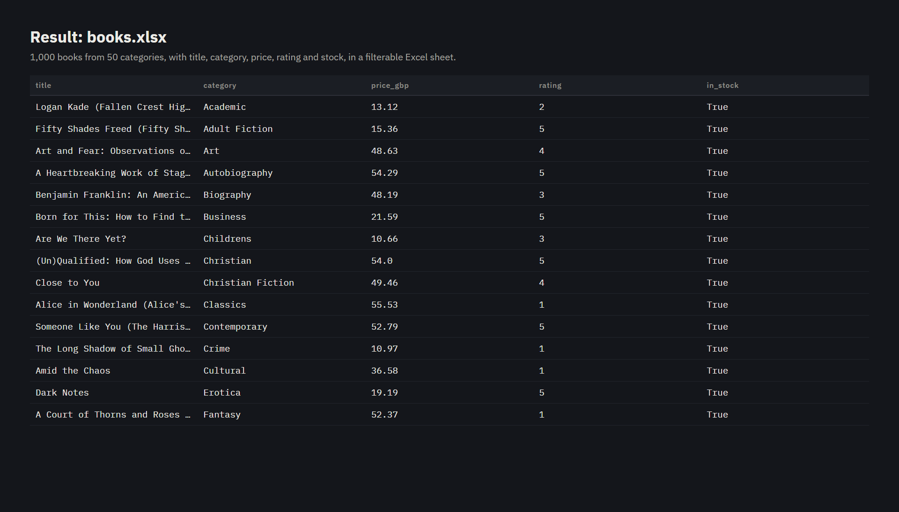
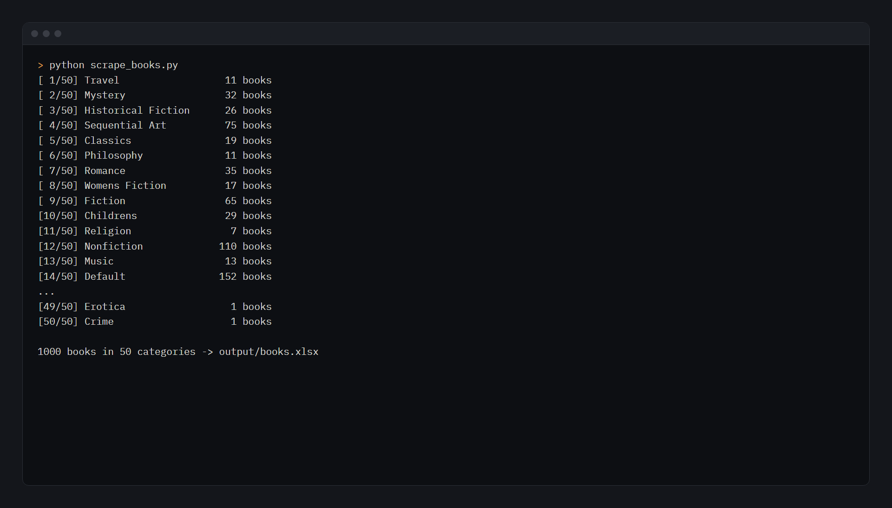

# Book Store Scraper

Scrapes every book from [books.toscrape.com](https://books.toscrape.com), a sandbox site built for scraping
practice, into a clean, filterable Excel file.



## What it does

- Reads the 50 categories from the sidebar and follows each category's "next" pages
- Collects title, category, price (£), star rating (1–5), stock status and the book's link
- Removes duplicates and sorts by category and title
- Writes `output/books.xlsx` with two sheets, **Books** (one row per book, frozen header, filters, sized columns) and
  **Summary** (books, average price and average rating per category), plus `output/books.csv`
- Waits 0.2 s between requests so the site isn't hammered

Result: **1,000 books in 50 categories.**

## Run it

```bash
pip install -r requirements.txt
python scrape_books.py
```



## Built with

Python · requests · BeautifulSoup · pandas · openpyxl

## Need data from a website?

I scrape product, price and listing data into clean Excel or CSV files for clients. Send me the link and the fields you need.

<a href="https://www.upwork.com/freelancers/~01b6c711b0162ca691"></a>
<a href="mailto:mazen.elnaghy@gmail.com"></a>

Built by [Mazen Elnaghy](https://github.com/mazenelnaghy-code) · [Portfolio](https://mazenelnaghy-code.github.io)
